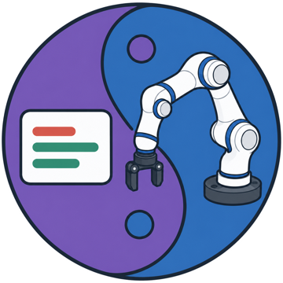
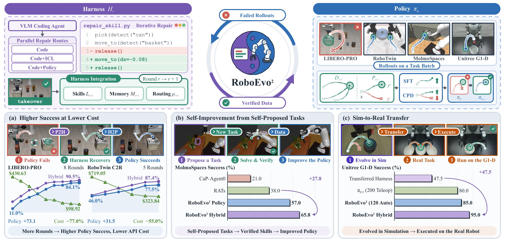
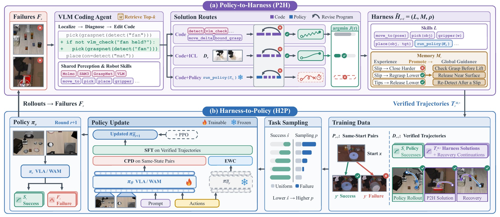

<p align="center">
  
</p>

<h1 align="center">RoboEvo²</h1>

<p align="center">
  <b>Recursive Robot Self-Improvement via Harness–Policy Co-Evolution</b>
</p>

<p align="center">
  
  
  
  
</p>

<p align="center">
  <a href="#overview">Overview</a> ·
  <a href="#start-here">Start here</a> ·
  <a href="#quick-start">Quick start</a> ·
  <a href="#connect-your-model">Connect your model</a> ·
  <a href="#evaluation">Evaluation</a> ·
  <a href="#repository-layout">Layout</a> ·
  <a href="#citation">Citation</a>
</p>

> When a robot policy fails, can the fix help it solve the next episode on its own? RoboEvo² uses an executable harness to search for a recovery. Verified actions become policy training examples, and useful procedures can become reusable harness skills. The next round starts with the harness and policy selected on development cases.

## Overview

<p align="center">
  
</p>

Each round moves experience in both directions:

|  | **Policy → Harness (P2H)** | **Harness → Policy (H2P)** |
| --- | --- | --- |
| **Starts from** | the current policy's failures | verified trajectories and same-state failure/repair pairs |
| **What happens** | a coding agent searches **Code**, **Code+ICL** and **Code+Policy** routes in parallel and keeps the verified fix with the lowest motion jerk | supervised training plus **Counterfactual Preference Distillation (CPD)** and EWC, with failure-aware task sampling |
| **Produces** | new or revised skills, memory and routing in the harness | the next policy, which then exposes the next failures |

<p align="center">
  
</p>

## Start here

| I want to… | Entry point |
| --- | --- |
| 🚀 Start a new evolution run | [Round-zero skills and empty memory](evolution/initial/README.md) · [Round runner and example config](evolution/README.md) |
| 🧪 Evaluate a policy by itself or with recovery | [LIBERO-PRO Hybrid evaluation](hybrid/README.md) |
| 🎯 Train or inspect a policy update | [Round-specific supervised, CPD and EWC update](evolution/README.md#policy-update) · [LIBERO-PRO training recipes](training/libero_v8/README.md) |
| 📈 Estimate Fisher information or run conditional PPO | [EWC](training/libero_ewc/README.md) · [Conditional PPO](training/conditional_ppo/README.md) |

## Quick start

From the repository root, use Python 3.11 or later to validate the example and inspect the starting harness on CPU.

```sh
python -m evolution.run evolution/config.example.json --workspace runs/quickstart --check
python -c "from evolution.initial.skills import initial_state; print(*initial_state()['skills'], sep=', ')"
```

The example binds a real LIBERO-PRO task to separate training and development initial states. For a native run, supply the benchmark assets, a compatible demonstration-trained policy and aligned robot demonstrations, and [connect your model](#connect-your-model). The [evolution guide](evolution/README.md) describes their formats, installation and commands.

## Connect your model

RoboEvo² ships no model client. The coding agent reaches your vision-language model through one function, `query_model(messages, settings)`, in [`hybrid/full_campaign/lharness/model_api.py`](hybrid/full_campaign/lharness/model_api.py). The evolution planner, the Hybrid evaluator and the repair runner all call it.

1. Replace the body of `query_model` with a request to your model. The module docstring describes the input: a system prompt, then text blocks and local PNG images in a fixed order. Return the reply text, which should be one JSON object.
2. Copy the finished file to [`hybrid/latest_repair/lharness/model_api.py`](hybrid/latest_repair/lharness/model_api.py). The repair runner keeps a self-contained copy.
3. Read credentials inside `query_model`, for example from an environment variable, and keep them out of the repository. Other settings, such as a model name or timeout, can go in the config's `coding_agent` block, which arrives as `settings`.

A minimal shape, with `my_client` standing for your own SDK or HTTP call:

```python
def query_model(messages, settings):  # image_base64() is defined in the same file
    system, user = messages
    parts = []
    for block in user["content"]:
        if block["type"] == "text":
            parts.append({"text": block["text"]})
        else:
            parts.append({"image_png_base64": image_base64(block)})
    reply = my_client.generate(system=system["content"], parts=parts,
                               model=settings.get("model"), json_output=True)
    return reply.text
```

Raise an exception if the request fails; the harness records it as an infrastructure error rather than a task failure. The model must accept several images per request.

## Evaluation

> [!NOTE]
> **Standalone** measures native success with the policy acting alone. **Hybrid** starts with the same policy and lets the harness take over after a failure. Native success stops execution.

The planner grounds targets in current camera frames, depth, calibration and robot feedback. The evaluator holds the simulator state used for scoring and for matching replay boundaries.

The [Hybrid evaluator](hybrid/README.md) covers eight LIBERO-PRO conditions, ten tasks per condition and ten held-out initial states per task. It has its own skills and memory. The fresh evolution runner initializes from [the round-zero state](evolution/initial/state.json).

<details>
<summary><b>Setup and CPU preflight</b></summary>

<br>

`YOUR_ORG/libero-pro` (companion runtime) and `YOUR_HF_ORG/libero-pro` (v8 checkpoint) are placeholders until those are released.

Native evaluation uses the companion LIBERO-PRO checkout with its patched LIBERO, RLinf and OpenPI packages, OpenGL/EGL runtime, assets and checkpoints. Follow the [pinned runtime installation](training/conditional_ppo/README.md#runtime-setup) and activate its Python environment. For the Hybrid evaluator, start in its directory, configure the local paths and [connect your model](#connect-your-model).

```sh
cd hybrid/full_campaign
cp configs/campaign.example.json configs/campaign.local.json
export LIBERO_PRO_ROOT=/absolute/path/to/companion/libero-pro
# Set runtime_python, baseline_path, ppo_root and output_root in campaign.local.json.
python run.py preflight --adaptive-shards --shard-count 10
```

After preflight, `python run.py launch --adaptive-shards --shard-count 10 --execute --wait-for-idle` starts simulator workers and can call the configured planner. Use `python run.py summarize` to count direct successes, rescues, native failures and pending cases. Use the same config, output directory and shard count with `--resume` for an interrupted queue.

</details>

## Repository layout

```text
RoboEvo2/
├── evolution/            round runner: rollouts, repair search, policy update
│   └── initial/          round-zero harness: skills, memory, routing
├── hybrid/               LIBERO-PRO Hybrid evaluation
│   ├── full_campaign/    policy first; harness recovers in the same episode
│   │   └── lharness/model_api.py   connect your model here
│   ├── latest_repair/    revisit recorded policy failures and attempt recovery
│   └── perception/       optional SAM3 mask service
└── training/
    ├── libero_v8/        supervised and CPD training recipes
    ├── libero_ewc/       EWC training and Fisher estimation
    └── conditional_ppo/  PPO refinement from the SFT checkpoint
```

## Citation

If you find RoboEvo² useful in your research, please cite our paper:

```bibtex
@inproceedings{roboevo2,
  title         = {RoboEvo$^2$: Recursive Robot Self-Improvement via Harness--Policy Co-Evolution},
  author        = {TBD},
  booktitle     = {TBD},
  year          = {TBD},
  eprint        = {TBD},
  archivePrefix = {arXiv},
  primaryClass  = {cs.RO},
  url           = {TBD}
}
```

> [!NOTE]
> The paper is under review. Authors, venue, year and the arXiv link will be filled in once it is public.
